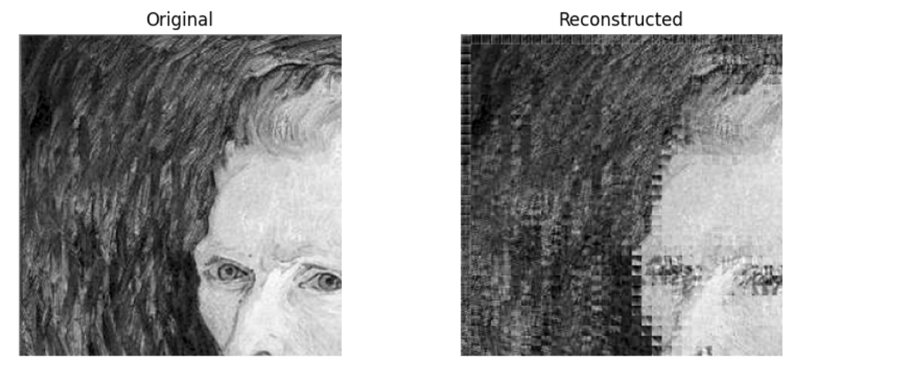
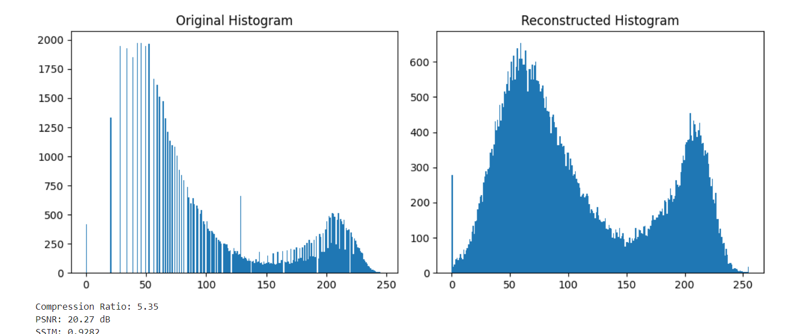

# Image Compression in Frequency and Spatial Domain

**Course:** Digital Image Processing
**University:** COMSATS University Islamabad, Abbottabad Campus
**Department:** Computer Engineering

**Students:** Laiba Qureshi, Huraima Abbasi


## Overview

A JPEG-style image compression pipeline written in Python. A grayscale 256x256 image is split into 8x8 blocks, transformed with the Discrete Cosine Transform (frequency domain), quantized, zigzag scanned, run-length encoded and Huffman coded. The image is then reconstructed by reversing the steps, and quality is measured with compression ratio, PSNR and SSIM.

## Pipeline

1. Read the image, convert to grayscale and crop to 256x256.
2. Divide into 8x8 blocks, subtract 128 and apply the 2D DCT.
3. Quantize with the standard JPEG luminance table.
4. Zigzag scan each block.
5. Run-length encode the coefficients.
6. Huffman code the RLE symbols.
7. Decode in reverse order and reconstruct the image.
8. Compute compression ratio, PSNR and SSIM.

## Installation and usage

```bash
pip install -r requirements.txt
python image_compression.py path/to/your_image.png
```

If no path is given, the script looks for `man.png` in the current folder.

## Results

| Metric | Value |
|---|---|
| Compression ratio | 5.35 |
| PSNR | 20.27 dB |
| SSIM | 0.9282 |

### Original vs reconstructed



### Histograms and metrics output



## Outputs produced by the code

- Original grayscale image
- Reconstructed (compressed and decompressed) image
- Histogram of the original image
- Histogram of the reconstructed image
- Compression ratio (data reduction)
- PSNR (signal-to-noise ratio in dB)
- SSIM (structural similarity)

## Repository structure

```
.
├── image_compression.py
├── requirements.txt
├── README.md
├── .gitignore
├── images/
│   └── comsats_logo.jpeg
└── results/
    ├── original_vs_reconstructed.png
    ├── histograms_and_metrics.png
    └── metrics.txt
```
